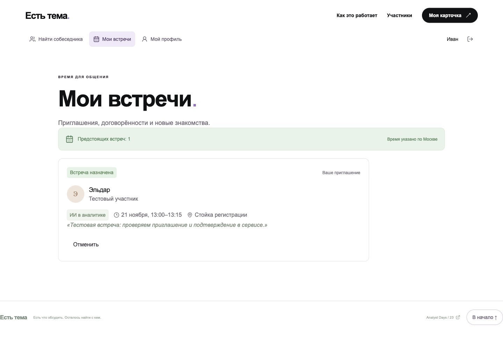

# Критерии приёмки и подтверждённый сценарий

## Подтверждённый результат 21 ноября

На опубликованном сайте пройдено создание тестовых аккаунтов, вход, публикация карточек, подбор, отправка и принятие приглашения в двух независимых сессиях. Машиночитаемые результаты — [production-scenario.json](../evidence/production-scenario.json).

Тестовая встреча Иван ↔ Эльдар: 21 ноября 2026, 13:00–13:15 МСК, «Стойка регистрации», «ИИ в аналитике». У обоих status=accepted, invitation id=2, slot_id=2, topic_id=1. У Ивана занятый слот исключён из дальнейшего подбора. Таисия также опубликована с доступностью, но встреча с ней в этом тесте не назначалась.

Скриншоты зафиксированы во время технического теста. Тестовые профили явно помечены описанием, но созданы обычной регистрацией и не исключаются автоматически из агрегатов. Факт офлайн-разговора и полезность не подтверждены.

## Как повторить

1. Организатор задаёт будущий непересекающийся интервал длительностью 15 минут и точку встречи. Старые интервалы не переиспользовать: тестовый 13:00–13:15 уже прошёл.
2. Два участника входят в разных профилях браузера/инкогнито. Новый аккаунт после регистрации скрыт.
3. Участники выбирают совместимые темы и общий будущий слот, включают «Участвовать в подборе» и сохраняют.
4. Первый получает второго с объяснением совпадения и приглашает, выбрав тему и время.
5. Получатель открывает «Мои встречи» и принимает. У обоих появляется «Встреча назначена» с одинаковыми темой, временем и местом.
6. Для проверки конфликта отдельным сценарием попытаться занять тот же слот; нельзя получить второй accepted у одного участника. Конкурентность покрыта API-тестом, в этом production-прогоне повторная конфликтная запись не создавалась.
7. До начала можно отменить, после окончания accepted доступна оценка; эти действия отдельно покрыты тестами и не являются частью последнего ручного прогона.

## Условия и доказательства

| Требование | Ожидаемое поведение | Доказательство |
| --- | --- | --- |
| Регистрация | Ошибки полей, согласие, скрытый профиль и сессия | Живой тест регистрации |
| Права доступа | Чужие приглашения недоступны, принимает получатель | API-тесты; принятие своим получателем на production |
| Подбор | Общая тема и будущее общее свободное время | Иван видит Эльдара и Таисию |
| Согласование | У обеих сторон одна назначенная встреча | API и два снимка выше |
| Конкурентность/идемпотентность | Нет двойной брони и дубля accepted | Конкурентный и повторный API-тесты |
| Прокси | Cookie, тело, статусы, безопасный 502 | 10 тестов прокси |
| Новый интерфейс | Четыре блока, прокрутка, reduced motion, читаемость | Браузерные проверки и снимки лендинга |
| Хранение после пересоздания | Данные сохраняются с постоянным диском | Исторический volume-тест CI; RelaxDev не подтверждён |

Пароли тестовых аккаунтов и организатора не входят в комплект. Для доступа к оставленным тестовым аккаунтам владелец использует свой отдельный локальный файл. Не публиковать его, cookie или базу участников.
