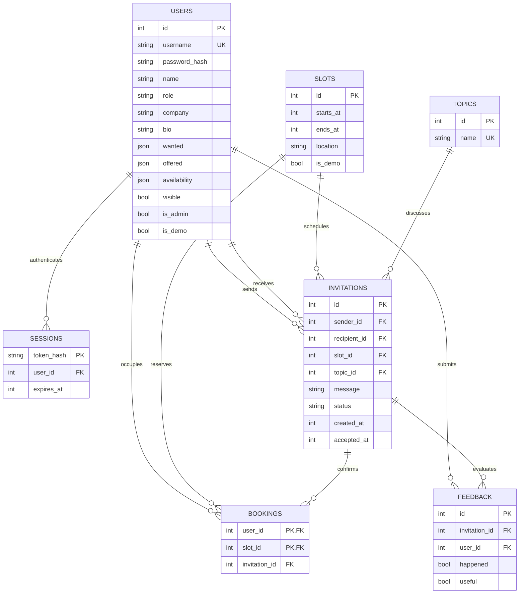
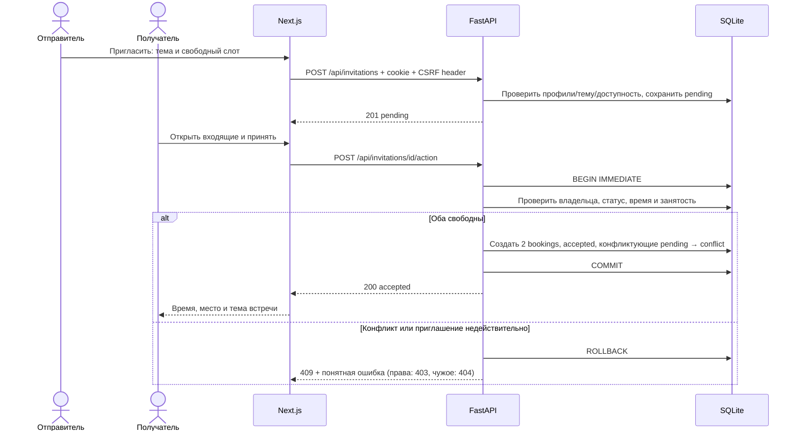

# Архитектура и процесс

Два отдельных Git-репозитория и сервиса. Представление — Next.js, бизнес-логика — FastAPI, данные — SQLite/SQLAlchemy. Браузер обращается к `/api/*` домена frontend; Next.js пересылает запросы самостоятельному backend. Серверный маршрут proxy транспортный, бизнес-правил не содержит. Внутри backend данные доступны через ORM.

## ERD

Списки тем/доступности профиля хранятся JSON и ссылаются логически на TOPICS/SLOTS; валидируются сервером, не внешним ключом внутри JSON. Уникальны username, название темы, занятость `(user_id,slot_id)` и оценка `(invitation_id,user_id)`. Внешние ключи включены через PRAGMA. Удаление пользователя каскадное. Удаления справочников в MVP нет. Миграция не задаёт SQLite AUTOINCREMENT; устойчивость идентификаторов при будущем удалении справочников потребует отдельного решения.

## Sequence: принятие приглашения

## Состояния

`pending → accepted / declined / cancelled / conflict`. После начала pending отображается expired, принятие запрещено. `accepted → cancelled` только до начала; отмена освобождает bookings. Конфликтные приглашения не восстанавливаются автоматически. Оценка доступна после ends_at, только участникам accepted. «Состоялась» требует двух положительных подтверждений.
