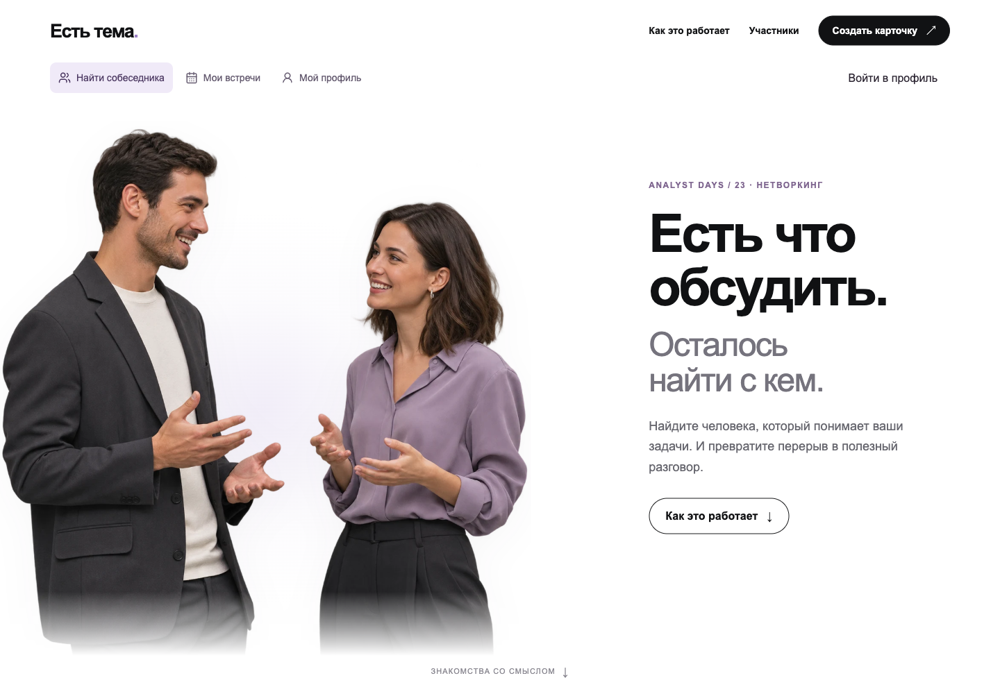
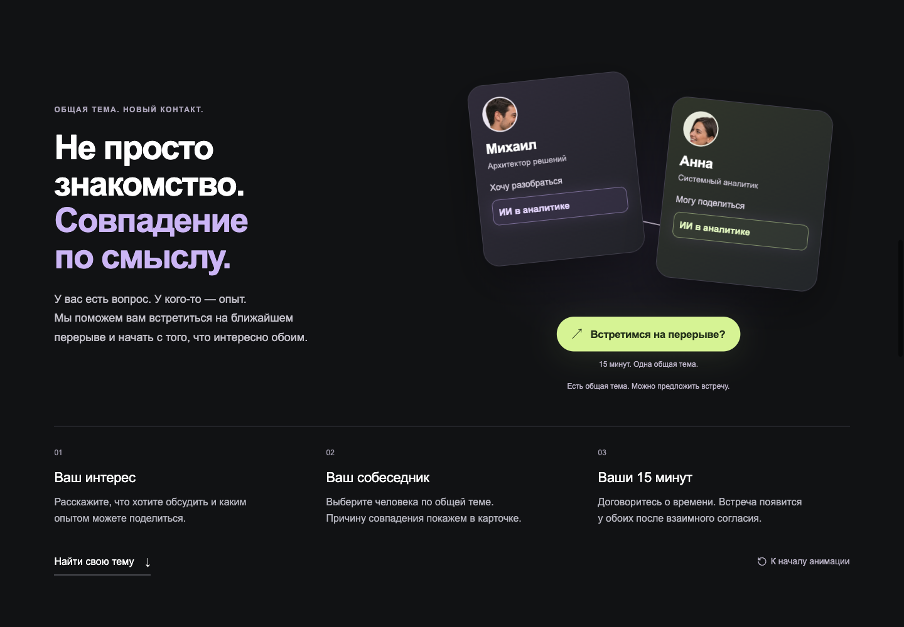
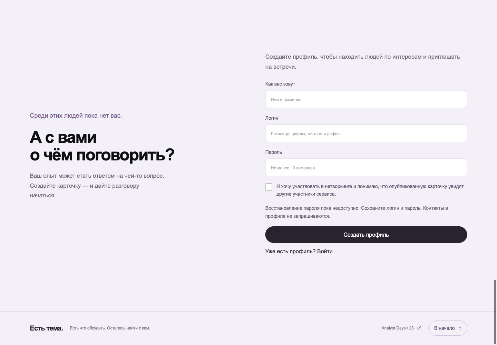
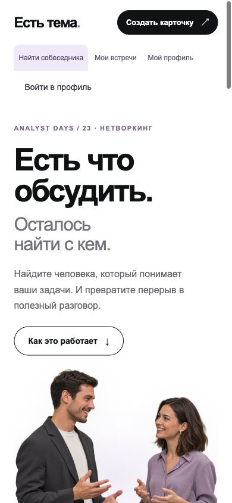
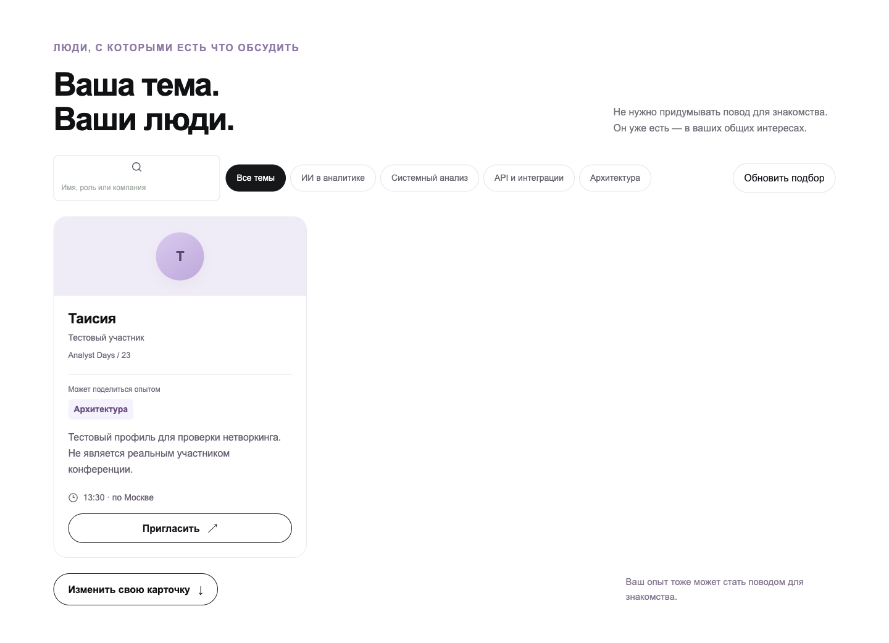

# Лендинг продукта: утверждённый дизайн

[Открыть «Есть тема»](https://got-a-topic-frontend.isodomain.tech/). Четыре блока встроены в приложение. Снимки сделаны с опубликованной версии 21 ноября 2026 года; это работающий интерфейс, а не отдельный прототип.

| Блок | Ценность и целевое действие |
| --- | --- |
| Первый экран | «Есть что обсудить. Осталось найти с кем.» Люди в разговоре, короткое обещание пользы; «Как это работает» ведёт к объяснению |
| Совпадение по смыслу | У одного вопрос, у другого опыт. Карточки сближаются по скроллу; общая тема и кнопка «Встретимся на перерыве?» ведут к подбору |
| Ваша тема. Ваши люди. | Рекомендации с объяснением и общим временем; поиск и темы. Для гостя — предложение создать профиль |
| А с вами о чём поговорить? | Ценность собственного опыта; реальная регистрация или редактирование карточки. Подвал возвращает в начало |

На desktop секции занимают минимум экран; при недостатке места растут по содержимому. Сцена закрепляется, когда помещается в окно. Жест останавливается на границе следующего блока; кнопки переходят непосредственно к цели. Движение обратимо и замирает без прокрутки; reduced motion отключает закрепление и анимацию. Основные описания увеличены до 16–18 px.

## Снимки опубликованного сайта

## Доступные участники после тестовой встречи

Снимок сделан после назначения встречи: состав рекомендаций меняется с занятостью, временем и ограничением повторных приглашений. В момент снимка Ивану показана Таисия. Историческое появление Эльдара перед отправкой подтверждено сценарием приёмки.

## Подтверждение и границы

Проверены ширины 1440, 1024, 768, 390 и 320 px: горизонтального переполнения нет, изображение загружается. Маршрут `/images/conversation-hero.webp` отвечает 200. Исправление Docker добавляет папку `public` в финальный образ. Результаты — [проверки публичной версии](../evidence/public-checks.json).

Изображение создано с помощью ИИ и утверждено пользователем. Анна и Михаил в анимации — иллюстрация механизма, не реальные рекомендации. Тестовые Иван, Эльдар и Таисия участвуют в настоящем API-сценарии; их технический тест не доказывает полезность для реальных участников. Конверсия лендинга и продуктовый эффект не измерены.

[ТЗ Frontend](frontend-spec.md), [приёмка](acceptance.md), [сценарий выступления](demo-script.md).
